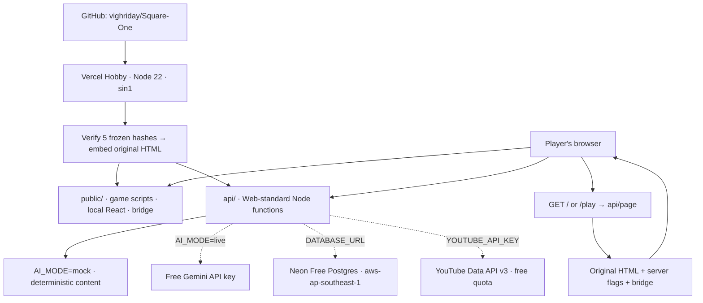

# Vercel deployment

Start with the account-free mock demo. It plays the complete game using generated practice content, needs no database or API keys, and keeps player progress in that browser. Add live services after the demo is running.

## Deployment schema



### Route map

| Public URL | Handler / asset | Demo behavior |
| --- | --- | --- |
| `/`, `/play` | `api/page.js` | Inject flags and bridge; set anonymous cookie |
| `/sq-bridge.js`, `/sq-*.js`, `/support.js`, `/vendor/*` | `public/` | Local game and runtime assets |
| `/api/ai/complete` | `api/ai/complete.js` | Validated mock fort, warm-up, room and extras |
| `/api/save` | `api/save.js` | 204 without DB; bridge backup is disabled without DB |
| `/api/health` | `api/health.js` | Mock mode, DB off, frontend locked |
| `/api/youtube/search`, `/api/youtube/videos` | matching handlers | 503 until a server key is set; game has YouTube search links |
| `/api/stats`, `/stats` | stats handlers | Zero aggregates until a database is configured |
| `/%7B%7B...` | `api/junk.js` rewrite | 204 for the raw template iframe |

`vercel.json` is the executable deployment configuration. Static assets use `public/`; generated HTML is imported into the page function so runtime filesystem access is unnecessary. `design/` and tests are excluded from the Vercel upload.

## Launch a working demo

1. Sign in to [Vercel](https://vercel.com/new) with GitHub on the **Hobby** plan.
2. Import **vighriday/Square-One**. Select **Other** as the framework. The GitHub repository root is the project root; do not enter `backend-arch-ref` here (that is only this workspace's containing folder).
3. Set Node.js to **22.x**. Use install command `npm ci`, build command `npm run build`, output directory `public`. `vercel.json` sets function region **sin1** and maximum duration **90 seconds**.
4. Add `AI_MODE=mock` to **Preview and Production** environments. Optionally add a random `IP_SALT` generated with `node -e "console.log(require('crypto').randomBytes(32).toString('hex'))"`. Leave DATABASE_URL, GEMINI_API_KEY and YOUTUBE_API_KEY unset for this demo.
5. Click **Deploy**. Open `/api/health`, then `/`. Enter the game, choose **Excel**, fire the three correct warm-up answers, open a terminal, fight a monster and continue. A perfect warm-up intentionally starts at room 6.
6. Share the production URL. Vercel Preview URLs can be protected by deployment protection; give viewers access or use the production URL for the public demo.

Expected health: `ok:true`, `db:"off"`, `ai.mode:"mock"`, `youtube:false`, `sync:false`, `frontendLocked:true`. Missing IP_SALT causes a warning, not a broken demo. Mock content is deliberately generic and must be presented as a mock, rather than live subject tutoring.

If the Vercel connection is available in Codex, the same project/settings can be deployed through it. This checkout did not contain Vercel login credentials; until the account is connected/imported, there is no claimed live deployment URL.

## Add Neon, Gemini and YouTube

1. Create a **Neon Free** project in **AWS Asia Pacific (Singapore), `aws-ap-southeast-1`**. Keep Vercel in **sin1**. Copy the pooled Postgres URL from Neon's Connect dialog. Make a separate Neon branch for preview/test data.
2. Put that branch's URL in a local ignored `.env.local` as DATABASE_URL. Run `npm run migrate`. The migration is transactional and idempotent. First exercise saves and erasure on the branch; use the production URL only when preparing the production schema.
3. Create a free Gemini API key in [Google AI Studio](https://aistudio.google.com/apikey). Keep the project on the free API tier. Set GEMINI_API_KEY in Vercel. Change AI_MODE from `mock` to `live`; use `live+mock` only if a disclosed mock fallback is acceptable.
4. Enable **YouTube Data API v3** in a Google Cloud project and create a server API key restricted to that API. Set YOUTUBE_API_KEY in Vercel. Do not paste the server key into the game's Settings.
5. Set DATABASE_URL and a stable random IP_SALT in Vercel. Set Preview DATABASE_URL to the test branch and Production DATABASE_URL to the production branch/database. Run `npm run migrate` once against each target.
6. **Redeploy** after changing environment variables. Existing deployments keep their original environment. The code chooses live AI automatically when a key is present and AI_MODE is unset; explicitly setting AI_MODE avoids demo confusion.

| Variable | Mock demo | Live demo |
| --- | --- | --- |
| `AI_MODE` | `mock` | `live` |
| `DATABASE_URL` | Unset | Neon pooled URL |
| `GEMINI_API_KEY` | Unset | Free AI Studio key |
| `YOUTUBE_API_KEY` | Unset | YouTube v3 server key |
| `IP_SALT` | Recommended random value | Stable random value |
| `STATS_PUBLIC` | `true` or unset | `true` to show `/stats`; `false` hides both stats routes |
| `GEMINI_MODEL`, `GEMINI_FAST_MODEL` | Unset | Optional supported free-tier model override |
| `ALLOWED_ORIGINS` | Unset | Only needed for explicitly trusted extra POST origins |

## Preview acceptance checks

- `/` and `/play` render the game; `/vendor/*` returns 200; the browser never requests unpkg.
- `/api/health` reports `db:"up"`, live mode, YouTube/sync true, frontend locked and no warnings when all services are configured. `lastModel` is instance-local diagnostic information and may be null in a separate serverless health instance.
- Build **Excel** in English, then repeat in a fresh browser using the same language. Confirm `cached:true` in the API replies, lower latency, and `ai_calls.cached=true` in Neon. Matching cache keys depend on the whole prompt, including language.
- Open a terminal and confirm a real video appears; the browser requests `/api/youtube/*`, with no server key in page source or network URLs.
- Play a room, wait for backup, then use **Esc → Settings → Erase saved game → Tap again to erase**. Confirm the player's `saves.game is null` (SQL NULL).
- `/stats` updates after at most ten seconds. Hit the encoded junk path once; expect 204. If Vercel doesn't match the junk rewrite, a harmless template 404 is the documented allowed fallback—record the preview result in FINDINGS.

Useful SQL (run in the correct Neon branch):

```sql
select kind, cached, ok, model, ms, created_at
from ai_calls order by created_at desc limit 20;

select player_id, game is null as erased, room, rooms_done, updated_at
from saves order by updated_at desc limit 10;
```

## Demo-day checklist

- Open `/api/health` a minute before presenting to wake Neon; check it again before starting.
- Test one real Excel build, its repeat cache hit, a video and stats on the exact shared deployment URL.
- Keep a second free Gemini key ready privately. To swap, change the Vercel environment and redeploy. Never log or commit either key.
- Keep the offline Python sample ready. If live service quota is exhausted, a separate `AI_MODE=mock` deployment is a predictable fallback; label it clearly.
- Leave browser saves intact on the presentation machine. Cloud saves are backups; this specification does not include cross-device restore or login.
- Keep costs at zero: Hobby, Neon Free, Gemini free tier, and the free YouTube quota. The app never enables billing or provisions paid capacity.

## Roll back

Use Vercel's deployment history to promote the last working deployment. For a reliable account-free fallback, set AI_MODE=mock, unset DATABASE_URL and YOUTUBE_API_KEY, and redeploy. The sample Python fort also works with no environment variables.

Implementation references: [Vercel Node Web handlers](https://vercel.com/docs/functions/runtimes/node-js), [Gemini thinking settings](https://ai.google.dev/gemini-api/docs/thinking), and [Gemini free/paid API tiers](https://ai.google.dev/gemini-api/docs/pricing). Use the free API tier; this code never upgrades the account.
