<!-- Two placeholders to replace before you publish: YOUR-APP (your Vercel address) and YOUR-ORG (your GitHub account). -->

<p align="center">
  <a href="https://YOUR-APP.vercel.app">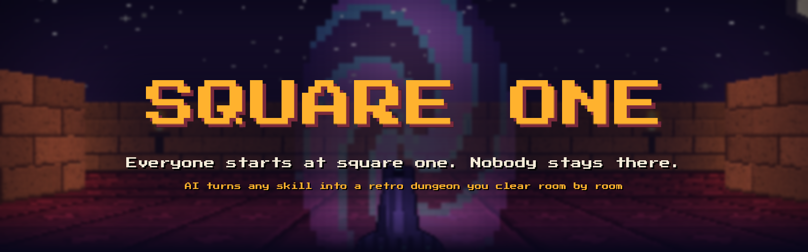</a>
</p>

<p align="center">
  <a href="https://YOUR-APP.vercel.app"></a>
  <a href="#-run-it-locally"></a>
  <a href="#-architecture"></a>
</p>

<p align="center">
  
  
  
  
  
  
  
  
</p>

<p align="center">
  
  
  
  
</p>

<p align="center">
  <a href="#-what-is-square-one">What it is</a> ·
  <a href="#-screenshots">Screenshots</a> ·
  <a href="#-how-to-play">How to play</a> ·
  <a href="#-architecture">Architecture</a> ·
  <a href="#-tech-stack">Tech stack</a> ·
  <a href="#-run-it-locally">Run it</a> ·
  <a href="#-deploy">Deploy</a> ·
  <a href="#-roadmap">Roadmap</a>
</p>

---

## 🎮 What is Square One?

Learning a new skill feels like a maze with no map. **Square One gives you the map, and makes it a game.**

Type any skill. AI builds a **fort** for it: **4 floors, 20 rooms**, one small step per room. In every room you read a glowing terminal, do the step, then face a monster that tests the **most common mistake** on that step. Fire the right answer to get the keycard, and the next door opens.

<p align="center">
  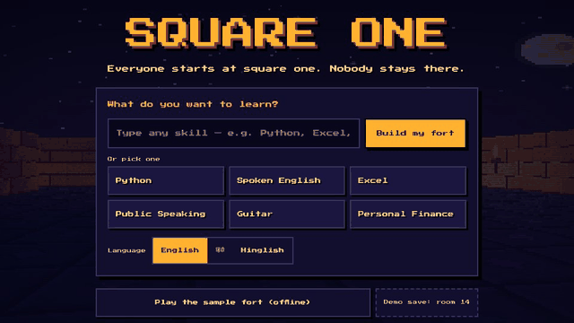
  <br><sub>Real gameplay from the built-in Python fort: warm-up → Square One → terminal → monster → keycard → room 2.</sub>
</p>

<table>
  <tr>
    <td width="33%" valign="top"><b>🧭 Meets you where you are</b><br>3 warm-up dummies decide your start. Know the basics? The lift takes you straight to floor 2.</td>
    <td width="33%" valign="top"><b>🔑 Prove it to pass</b><br>Every door needs a keycard, and every keycard needs one right answer about that step.</td>
    <td width="33%" valign="top"><b>🌀 Nobody gets lost</b><br>Lose to an elite monster and a portal takes you to the exact room that teaches it, then brings you back.</td>
  </tr>
  <tr>
    <td valign="top"><b>📺 Real videos, not AI guesses</b><br>The server compares real YouTube videos by views, likes and length, and picks one for each step.</td>
    <td valign="top"><b>🗣️ English, हिंदी, Hinglish</b><br>All game text and all AI content in your language.</td>
    <td valign="top"><b>📱 Any phone, no install</b><br>A retro 3D engine drawn small and scaled up, so it stays smooth on a basic Android.</td>
  </tr>
</table>

---

## 🖼 Screenshots

<table>
  <tr>
    <td width="50%">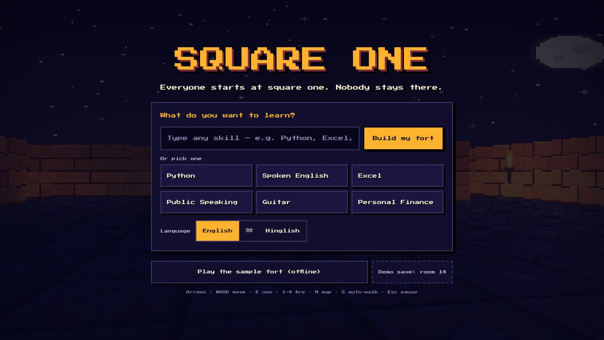<br><sub><b>Title.</b> Type any skill or pick one. No sign-up.</sub></td>
    <td width="50%">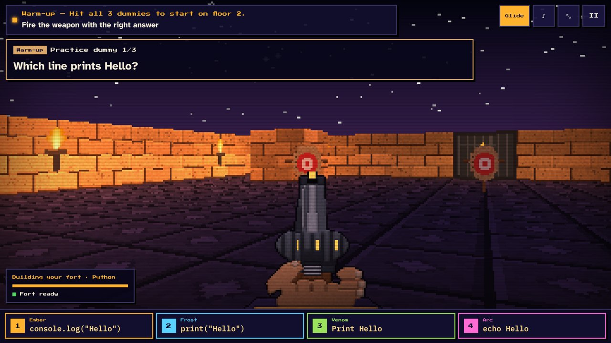<br><sub><b>Warm-up.</b> 3 dummies place you while the AI builds your fort.</sub></td>
  </tr>
  <tr>
    <td>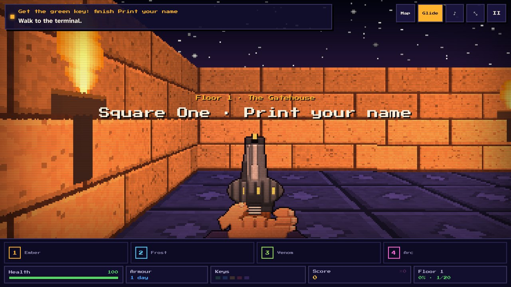<br><sub><b>Square One.</b> Room 1 is always a 2-minute task.</sub></td>
    <td>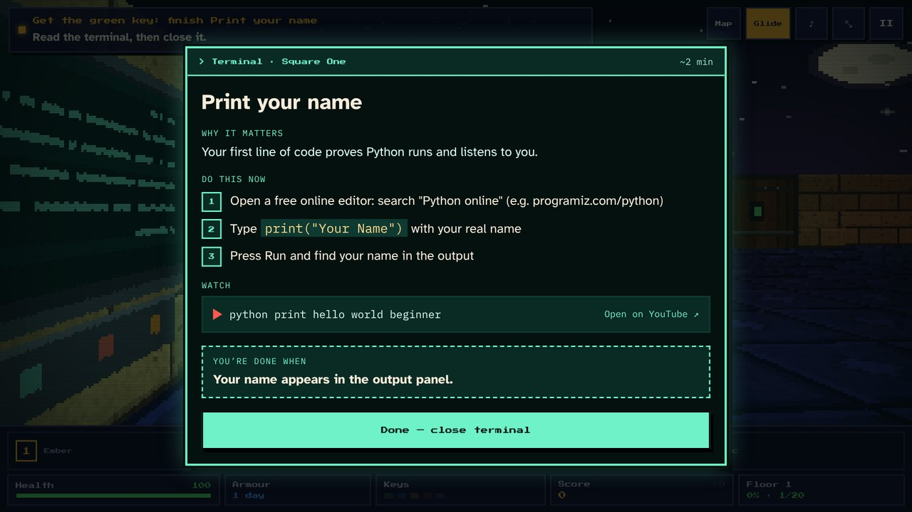<br><sub><b>Terminal.</b> Why it matters, what to do now, a video, and when you're done.</sub></td>
  </tr>
  <tr>
    <td>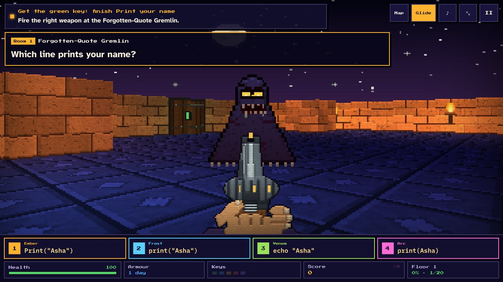<br><sub><b>Fight.</b> The 4 weapons are the 4 answers. Keys 1–4 or tap.</sub></td>
    <td>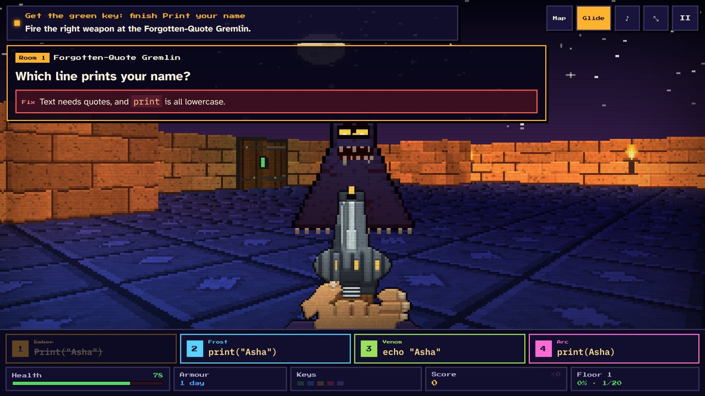<br><sub><b>Instant feedback.</b> A wrong answer costs health and shows the one-line fix.</sub></td>
  </tr>
  <tr>
    <td>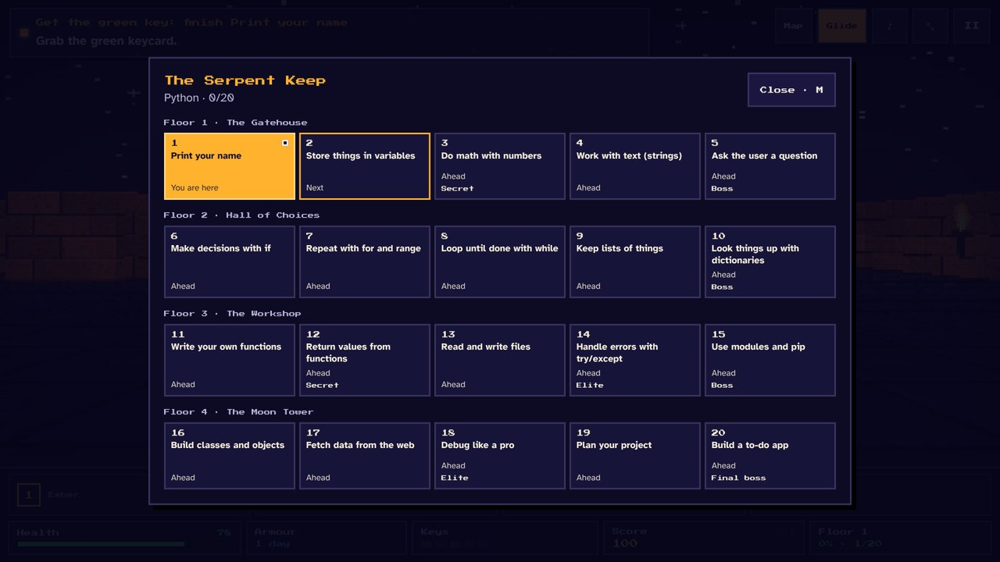<br><sub><b>Map.</b> The whole roadmap: done, next, ahead, secrets, elites, bosses.</sub></td>
    <td>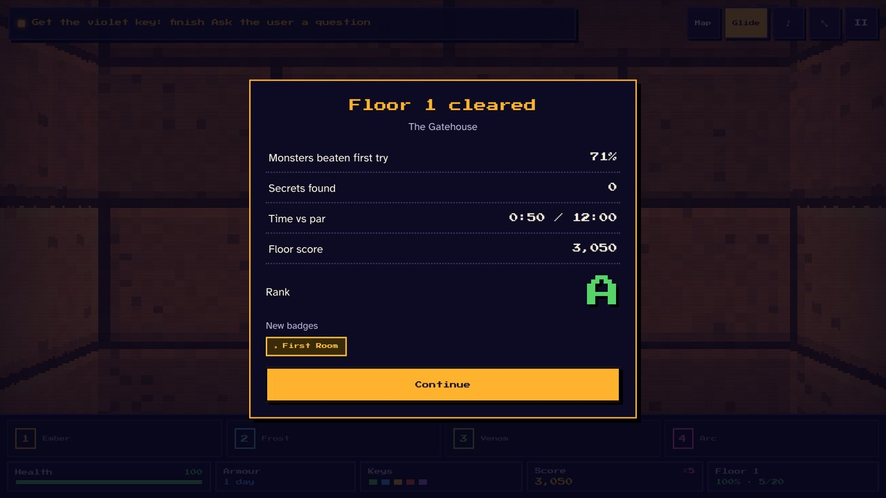<br><sub><b>Floor cleared.</b> First-try rate, secrets, time against par, and a rank.</sub></td>
  </tr>
  <tr>
    <td>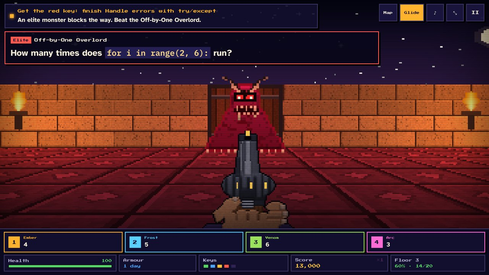<br><sub><b>Elite monster.</b> Rooms 14 and 18 test a classic mistake from earlier.</sub></td>
    <td>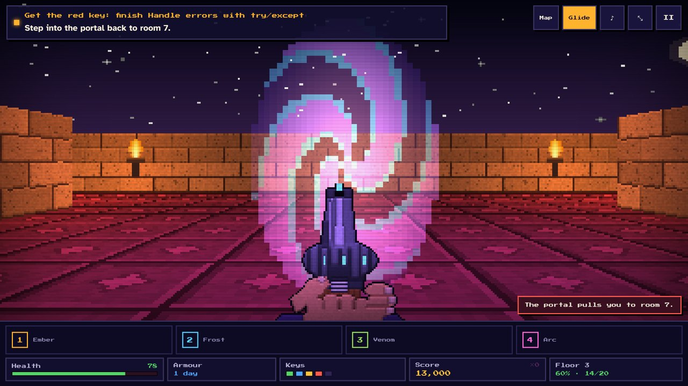<br><sub><b>Portal.</b> Lose, and you're sent back to fix just that one thing.</sub></td>
  </tr>
</table>

<p align="center">
  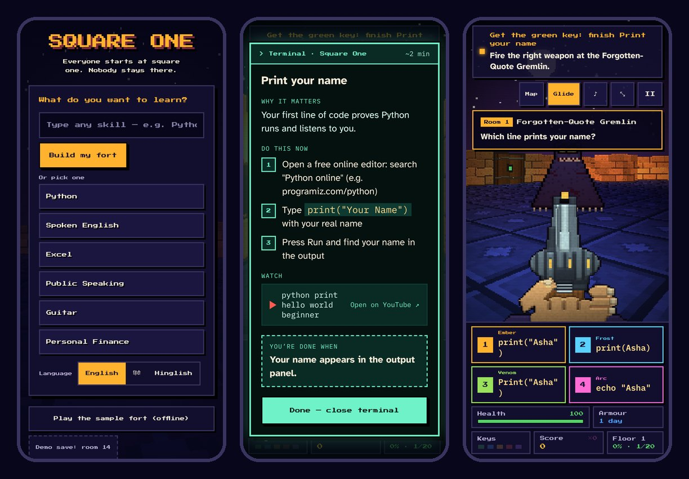
  <br><sub>On a phone: the game walks for you, and the 4 answers become 4 big buttons.</sub>
</p>

<details>
<summary><b>हिंदी में देखें (Hindi interface)</b></summary>
<br>
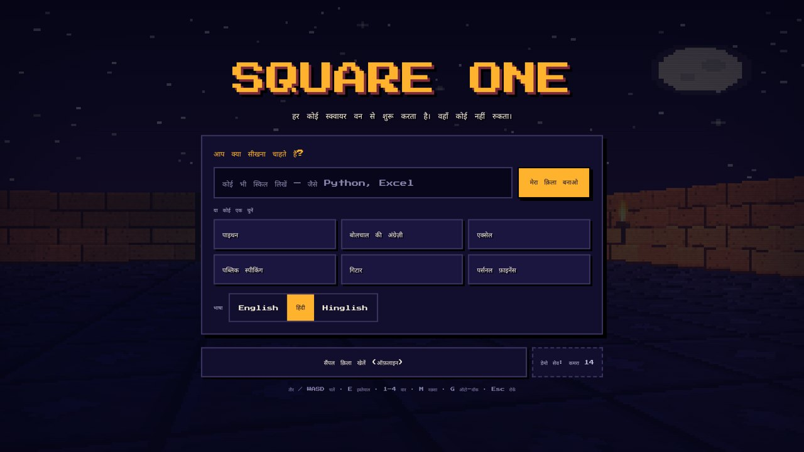
</details>

---

## 🕹 How to play

| | Laptop | Phone |
| --- | --- | --- |
| Move | Arrow keys or W A S D | Automatic (the game glides you to the next thing) |
| Use the terminal | `E` or `Enter` | Tap **Open terminal** |
| Fire an answer | `1` `2` `3` `4` | Tap one of the 4 answer buttons |
| Map | `M` | Tap **Map** |
| Auto-walk on / off | `G` | Tap **Glide** |
| Pause, settings | `Esc` | Tap **II** |

### Every game piece has a learning job

| | Game piece | What it means for learning |
| :---: | --- | --- |
|  | **Warm-up dummies** | 3 quick questions while the fort is built. All 3 right: start on floor 2. |
| 🖥️ | **Terminal** | The step itself: why it matters, 3 to 5 things to do now, a video, and how you know you're done. |
|  | **Monster** | The most common mistake on this step, as one question. |
|  | **Keycard** | Proof you finished the step. It opens the door. |
| 🧱 | **Secret wall** (rooms 3 and 12) | Answer 3 quick questions to skip 5 rooms you already know. |
|  | **Elite monster** (rooms 14 and 18) | Tests a classic mistake from an earlier room. |
|  | **Portal** | Lose to an elite and it takes you to the room that teaches it, then back. |
|  | **Boss** (every 5th room) | A short mixed review of the whole floor. |
| ❤️ 🛡️ | **Health, armour** | Wrong answers cost health; at zero you restart the room and lose nothing. Armour grows with your day streak. |
| 🏆 | **Score, combo, rank, badges** | Right answers in a row multiply your score; every floor ends with a rank from C to S. |

### The bestiary

<p align="center">
  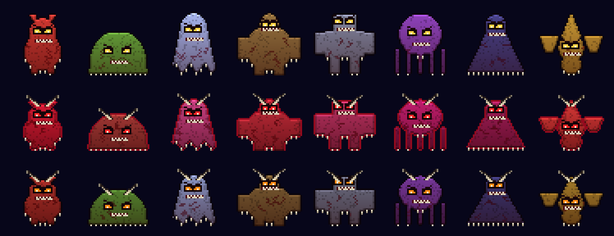
  <br><sub>8 monster types in normal, elite and boss form, all drawn in code. The AI names each one after a real mistake: the <i>Off-by-One Imp</i>, the <i>Forgotten-Quote Gremlin</i>, the <i>KeyError Kraken</i>.</sub>
</p>

---

## 🔁 The core loop

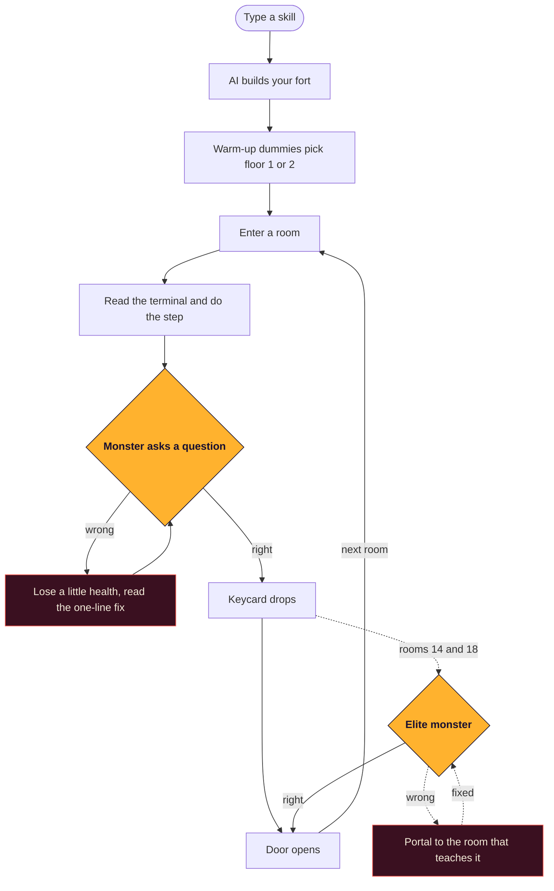

---

## 🏗 Architecture

The game itself is **never edited**. It was built in Claude Design and expects three things only Claude provides. A thin free server provides them instead, through one small script, `sq-bridge.js`, that the server adds to the page as it loads.

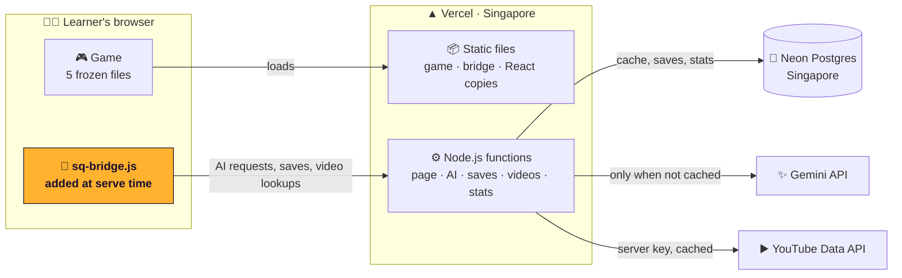

| The game expects | On a normal website | What the backend does |
| --- | --- | --- |
| `window.claude.complete()` for all AI content | Doesn't exist, so only the offline fort works | The bridge creates it and sends each request to our server |
| React from unpkg.com on every visit | A slow or blocked CDN means the game never starts | The page runtime's own `window.__resources` hook points React at our copies (byte-identical, same SRI hashes) |
| A YouTube key typed into Settings | Nobody has one, and a typed key is visible | The server looks videos up with its own hidden key and caches them |
| Saves in the browser only | Cleared browser = lost progress, no numbers | Every save is backed up to Neon, and `/stats` shows live numbers |

### ⚡ What happens when you build a fort

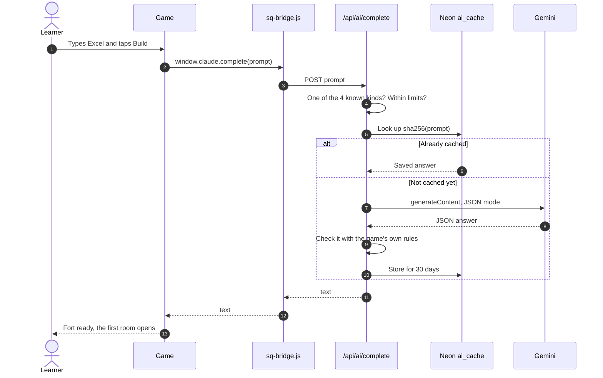

A brand-new skill takes up to **23 AI requests** over a whole playthrough (1 fort, 1 warm-up, 1 extras, 20 rooms). A skill someone has already played in the same language takes **zero**.

---

## 🧰 Tech stack

| | Layer | What we use | Why |
| :---: | --- | --- | --- |
|  | Game engine | Plain JavaScript on an HTML canvas, ray-casting (the 3D trick from Wolfenstein 3D), drawn small and scaled up | Smooth on low-end phones, nothing to install |
|  | Screens and menus | React 18.3.1 through the Claude Design runtime | Terminal, map, fights and HUD |
| 🔊 | Sound | Web Audio API, chiptune generated in code | No sound files to download |
|  | Fonts | Press Start 2P, Atkinson Hyperlegible, IBM Plex Mono, Noto Sans Devanagari | Retro look, easy reading, Hindi support |
| 🔌 | Bridge | `sq-bridge.js`, inserted by the server | Connects the finished game to the backend without changing it |
|  | Hosting | Vercel Hobby: static files plus Node.js 22 functions, region `sin1` | Free, one deploy for both, a preview link for every change |
|  | Database | Neon serverless Postgres, Singapore, saves as `jsonb`, HTTP driver | Free, sleeps when idle, standard SQL, instant test branches |
|  | AI | Gemini 3.8 Flash (main), 3.5 Flash-Lite (warm-up), JSON output, automatic model fallback | Free key, fast, reliable structured answers |
|  | Videos | YouTube Data API v3, ranked on the server | Real videos picked by real numbers |
| 🧪 | Quality | `node:test`, Playwright end-to-end, SHA-256 lock on the 5 game files | Proves the game works and its files never changed |

<p align="center">
  
</p>

---

## 🗄 Data model

One free Neon Postgres database, 7 tables, no second service. Learners are anonymous: a random cookie id, no names, emails or phone numbers, and IP addresses stored only as a salted hash.

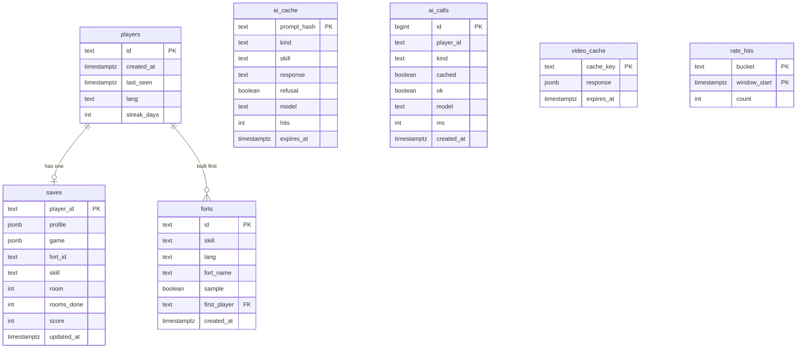

## 🔌 API

| Route | What it does | Limit |
| --- | --- | --- |
| `GET /` · `/play` | The game page, with the bridge added | none |
| `POST /api/ai/complete` | Answers the game's AI requests: cache first, then Gemini | 40 per learner and 120 per IP every 10 min · 12,000 characters |
| `POST /api/save` | Backs up the latest profile and game | 30 per learner per minute · 1 MB |
| `GET /api/youtube/search` · `/videos` | YouTube lookups with the server key, cached | 30 per learner every 10 min |
| `GET /api/health` | What's switched on: database, AI, YouTube, last model used | none |
| `GET /api/stats` · `/stats` | Live numbers, as data and as a page for judges | none |

---

## 🧠 Memory: GraphRAG (planned)

Today the game remembers each learner's progress and every AI answer. Next, it will remember **what each learner actually knows and keeps getting wrong, across every skill**, in a graph that lives in the same Neon database (pgvector plus two tables, no separate graph database).

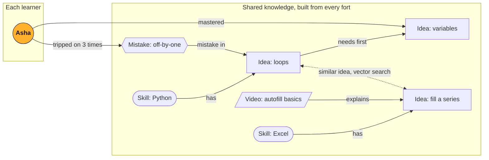

1. Every fort adds its ideas, mistakes and chosen videos to the graph.
2. Each idea gets an embedding (Gemini Embedding 2) stored with pgvector, so the same idea is found across skills and languages.
3. Before the AI writes a room, the server pulls what this learner has mastered and keeps tripping on, and adds a short note to the request: *"Asha already knows variables and often makes off-by-one mistakes."*
4. The room skips what she knows, and the elite monster targets her real weak spot. Still no change to the game files.

---

## 🚀 Run it locally

> **Needs:** Node.js 22 and npm. No accounts needed for the first run.

```bash
git clone https://github.com/YOUR-ORG/square-one.git
cd square-one
npm install
AI_MODE=mock npm run dev        # http://localhost:3000, made-up AI content, no keys
```

With real AI, copy `.env.example` to `.env.local`, add your keys, then:

```bash
npm run migrate                 # creates the 7 tables in Neon (safe to run again)
npm run dev
```

### Settings

| Variable | What it is | Needed? |
| --- | --- | --- |
| `DATABASE_URL` | Neon connection string (the *pooled* one) | For saves, cache and stats |
| `GEMINI_API_KEY` | Free key from [Google AI Studio](https://aistudio.google.com/apikey) | For real AI |
| `AI_MODE` | `live` · `live+mock` · `mock` · `off` | Optional, default `live` when a key is set |
| `YOUTUBE_API_KEY` | YouTube Data API v3 key | Optional |
| `IP_SALT` | Any long random text | Yes |
| `GEMINI_MODEL` · `GEMINI_FAST_MODEL` | Force a specific model | Optional |

With **no settings at all** the game still runs and the offline Python fort works.

---

## ☁ Deploy

1. **Neon:** create a free project in **AWS Asia Pacific (Singapore)**, copy the pooled connection string.
2. **Vercel:** import the repo. Region is set to `sin1` in `vercel.json`. Add the settings above.
3. **Tables:** run `npm run migrate` once against the Neon database.
4. **Check:** open `/api/health` (everything green) and `/stats`.

**Demo-day checklist**

- [ ] Open `/api/health` a minute before you present (wakes the sleeping database)
- [ ] Build your demo skill once beforehand, so it loads instantly from the cache
- [ ] Keep a second Gemini key ready in Vercel
- [ ] Keep a second tab on the offline sample fort, and the built-in *Demo save: room 14*

---

## 🧪 Testing

```bash
npm run verify:frontend   # the 5 game files still match their SHA-256 fingerprints
npm test                  # validators, prompt classifier, mock AI, page injection, rate limits
npm run e2e               # Playwright: boots the game, builds a fort, fights, checks saves, 0 requests to unpkg
```

---

## 📁 Project structure

```text
square-one/
├── public/                 # served as-is
│   ├── Square One.dc.html  # 🔒 frozen game page
│   ├── support.js          # 🔒 frozen Claude Design runtime
│   ├── sq-data.js          # 🔒 frozen sample fort, languages, text
│   ├── sq-engine.js        # 🔒 frozen renderer, sprites, sound
│   ├── sq-game.js          # 🔒 frozen game logic
│   ├── sq-bridge.js        # the only new browser code
│   └── vendor/             # React 18.3.1, ReactDOM, Babel (self-hosted)
├── api/                    # Vercel functions: page, health, ai, save, youtube, stats
├── lib/                    # validators, AI client, cache, rate limits, YouTube, stats
├── db/schema.sql           # the 7 tables
├── scripts/                # dev server, migrate, verify-frontend, vendor copy
├── tests/                  # unit and end-to-end tests
├── docs/media/             # images in this README
├── frontend.lock.json      # SHA-256 fingerprints of the 🔒 files
├── AGENTS.md               # full backend spec
└── FINDINGS.md             # frontend issues found, reported but not changed
```

---

## 🗺 Roadmap

| ✅ Now: this hackathon | 🔜 Next: first month | 🔭 Later: 3 to 6 months |
| --- | --- | --- |
| Game and AI-built forts | GraphRAG learner memory | Teacher mode for a whole class |
| Neon saves and answer cache | Optional login (free managed auth on Neon) | Race a friend through one fort |
| Real videos, picked on the server | WhatsApp daily nudges | More Indian languages |
| Live stats page for judges | Speak your answers in Hindi | College and coaching partnerships |
| English, Hindi, Hinglish | Play offline, installable | Drop-off data improves weak rooms |

---

## 🐞 Known issues

Frontend issues are **reported, not patched**, because the game files are locked. See [`FINDINGS.md`](FINDINGS.md). The backend already works around most of them: no AI outside Claude, React from unpkg, a visible YouTube key, a missing favicon, and one junk request per visit.

---

## 🙏 Credits

- Built in **Claude Design**; backend built with **Codex** from [`AGENTS.md`](AGENTS.md).
- Fonts: [Press Start 2P](https://fonts.google.com/specimen/Press+Start+2P), [Atkinson Hyperlegible](https://fonts.google.com/specimen/Atkinson+Hyperlegible), [IBM Plex Mono](https://fonts.google.com/specimen/IBM+Plex+Mono) and [Noto Sans Devanagari](https://fonts.google.com/noto/specimen/Noto+Sans+Devanagari), all under the SIL Open Font License.
- Powered by [Vercel](https://vercel.com), [Neon](https://neon.com), [Google Gemini](https://ai.google.dev) and the [YouTube Data API](https://developers.google.com/youtube/v3).
- Inspired by the first-person classics of the early 90s. Every texture, sprite and sound here is drawn in code.

<p align="center">
  <br>
  
  <br>
  <sub><b>Everyone starts at square one. Nobody stays there.</b></sub>
  <br>
  <sub>© 2026 the Square One team. All rights reserved.</sub>
</p>
